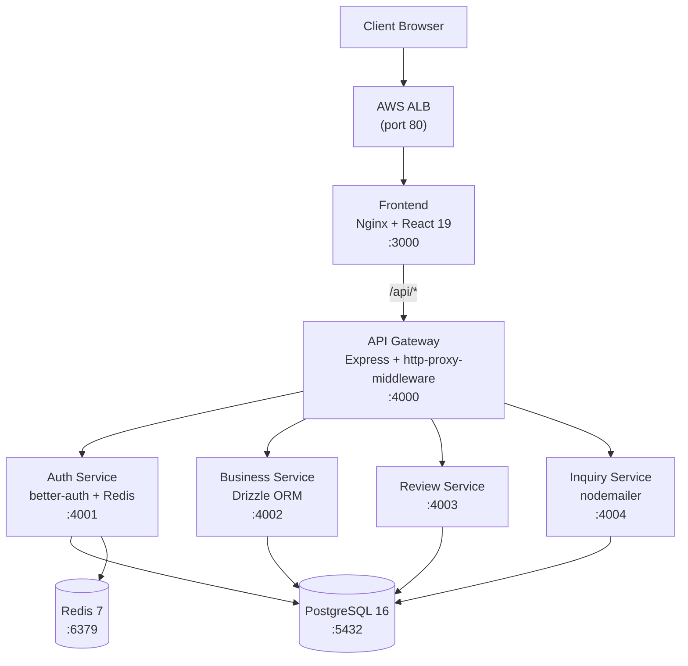

# BusinessConnect Platform

[](LICENSE)
[](https://nodejs.org/)
[](https://www.typescriptlang.org/)
[](https://docs.docker.com/compose/)
[](https://www.terraform.io/)

> A multi-tenant business directory platform benchmarking **AWS ECS Fargate** vs **EKS** deployment strategies. Built as the ShopNow DevOps benchmark — deploying the same multi-tier microservices application to two AWS container orchestrators and comparing service discovery, load balancing, auto-scaling, and resiliency.

---

## Table of Contents

- [Architecture](#architecture)
- [Services](#services)
- [Repository Layout](#repository-layout)
- [Prerequisites](#prerequisites)
- [Quick Start (Local)](#quick-start-local)
- [AWS Deployment](#aws-deployment)
  - [Infrastructure Provisioning](#infrastructure-provisioning)
  - [Build and Push Images](#build-and-push-images)
  - [ECS Fargate Deployment](#ecs-fargate-deployment)
  - [EKS Deployment](#eks-deployment)
- [ECS vs EKS Benchmark Results](#ecs-vs-eks-benchmark-results)
- [Resiliency Testing](#resiliency-testing)
- [Configuration](#configuration)
- [Security](#security)
- [Testing](#testing)
- [CI/CD](#cicd)
- [Cost Optimization](#cost-optimization)
- [Cleanup](#cleanup)
- [Contributing](#contributing)
- [License](#license)

---

## Architecture



### Traffic Flow

1. The browser connects to the AWS Application Load Balancer (port 80).
2. The ALB forwards all traffic to the **frontend** Nginx container (port 3000).
3. Nginx serves the React SPA for non-API paths and reverse-proxies `/api/*` requests to the **gateway** using the `GATEWAY_URL` environment variable (substituted at container start via `envsubst`).
4. The **gateway** is a thin Express proxy that routes by path prefix to the appropriate backend service.
5. Backend services validate sessions by calling `auth-service /api/auth/get-session` on every protected request — no JWT verification library required in each service.

### Service Discovery

| Platform   | Mechanism                  | Example address                                    |
|------------|----------------------------|----------------------------------------------------|
| Local dev  | Docker Compose DNS         | `http://auth-service:4001`                         |
| ECS        | AWS Cloud Map (DNS A)      | `http://auth-service.businessconnect.local:4001`   |
| EKS        | Kubernetes CoreDNS         | `http://auth-service.businessconnect:4001`         |

---

## Services

| Service           | Port | Technology                         | Responsibility                                      |
|-------------------|------|------------------------------------|-----------------------------------------------------|
| `frontend`        | 3000 | React 19, Vite, Tailwind CSS v4, Nginx | SPA with full UI; Nginx proxies `/api/*` to gateway |
| `gateway`         | 4000 | Express, http-proxy-middleware     | API reverse proxy, path-based routing to services   |
| `auth-service`    | 4001 | better-auth 1.2, ioredis, pg       | Email/password auth, session management via Redis   |
| `business-service`| 4002 | Express, Drizzle ORM, multer       | Businesses, categories, jobs, events, bookings, services, uploads |
| `review-service`  | 4003 | Express, Drizzle ORM               | Business star ratings and text reviews              |
| `inquiry-service` | 4004 | Express, Drizzle ORM, nodemailer   | Contact inquiries, owner email notifications        |
| `postgres`        | 5432 | PostgreSQL 16-alpine               | Primary relational database (shared schema)         |
| `redis`           | 6379 | Redis 7-alpine                     | better-auth secondary session store / cache         |
| `migrate`         | —    | Drizzle Kit (`db:push`)            | One-shot migration runner, executed as ECS task     |

### Gateway Route Map

| Path prefix       | Routed to          |
|-------------------|--------------------|
| `/api/auth`       | auth-service :4001 |
| `/api/businesses` | business-service :4002 |
| `/api/categories` | business-service :4002 |
| `/api/jobs`       | business-service :4002 |
| `/api/events`     | business-service :4002 |
| `/api/bookings`   | business-service :4002 |
| `/api/members`    | business-service :4002 |
| `/api/services`   | business-service :4002 |
| `/api/admin`      | business-service :4002 |
| `/api/stats`      | business-service :4002 |
| `/api/upload`     | business-service :4002 |
| `/uploads`        | business-service :4002 |
| `/api/reviews`    | review-service :4003   |
| `/api/inquiries`  | inquiry-service :4004  |

---

## Repository Layout

```
businessConnect/
├── docker-compose.yml          # Local dev stack (all 8 services + volumes)
├── init.sql                    # PostgreSQL seed data
├── .eslintrc.json              # ESLint config (typescript-eslint, import plugin)
├── .prettierrc                 # Prettier config (singleQuote, 100 printWidth)
│
├── frontend/                   # React 19 + Vite SPA
│   ├── Dockerfile              # Multi-stage: node:22 build → nginx:alpine
│   ├── nginx.conf              # Nginx template; envsubst replaces ${GATEWAY_URL}
│   └── src/
│       ├── pages/              # Route-level page components
│       ├── components/         # Shared UI and domain components
│       └── lib/                # API client, auth-client (better-auth), utils
│
├── services/
│   ├── auth-service/           # better-auth + Express; owns sessions in Redis + PG
│   ├── business-service/       # All business domain logic; Drizzle ORM; file uploads via multer
│   ├── review-service/         # Reviews; validates session via auth-service
│   ├── inquiry-service/        # Inquiries; sends owner emails via nodemailer
│   └── gateway/                # http-proxy-middleware routes; CORS gatekeeper
│
├── migrate/                    # Drizzle Kit migration runner
│   └── schema.ts               # Canonical schema (auth tables + app tables)
│
├── terraform/                  # AWS IaC (Terraform >= 1.6)
│   ├── providers.tf            # AWS provider, required_version
│   ├── variables.tf            # All input variables with defaults
│   ├── terraform.tfvars.example # Template — copy to terraform.tfvars (never commit)
│   ├── outputs.tf              # alb_dns_name, ecr_repository_urls, eks outputs
│   ├── vpc.tf                  # VPC, public/private subnets, IGW, route tables
│   ├── security_groups.tf      # Least-privilege SGs per service tier
│   ├── iam.tf                  # ECS execution/task roles, EKS cluster/node roles
│   ├── ecr.tf                  # 7 ECR repositories (one per image)
│   ├── ecs.tf                  # ECS cluster, Cloud Map, ALB, task definitions, services
│   ├── eks.tf                  # EKS cluster, managed node group, addon resources
│   └── autoscaling.tf          # ECS Application Auto Scaling (CPU + memory policies)
│
├── k8s/                        # Kubernetes manifests (applied to EKS)
│   ├── 00-namespace.yaml
│   ├── 01-configmap.yaml
│   ├── 02-secrets.yaml         # Base64-encoded dev secrets (do not use in production)
│   ├── postgres/               # PVC + Deployment + Service
│   ├── redis/
│   ├── auth-service/
│   ├── business-service/
│   ├── review-service/
│   ├── inquiry-service/
│   ├── gateway/
│   ├── frontend/
│   ├── hpa/                    # HorizontalPodAutoscaler for all stateless services
│   └── ingress/                # AWS ALB Ingress (requires ALB Controller)
│
├── scripts/
│   ├── 01-build-push.sh        # Build all images for linux/amd64 and push to ECR
│   ├── 02-deploy-eks.sh        # Substitute image URIs and apply k8s/ manifests
│   └── 03-resiliency-test.sh   # Kill a task/pod and time auto-recovery
│
└── docs/
    ├── ARCHITECTURE.md         # Architecture decisions (ADRs)
    ├── SECURITY.md             # Security model, secrets management, incident response
    └── COST_OPTIMIZATION.md    # Cost breakdown and saving strategies
```

---

## Prerequisites

| Tool        | Version  | Purpose                                         |
|-------------|----------|-------------------------------------------------|
| Docker      | >= 24    | Build images, run local stack                   |
| Docker Compose | v2    | Local multi-service orchestration               |
| Node.js     | >= 22    | Run services locally without Docker             |
| AWS CLI     | v2       | ECR auth, ECS/EKS control plane commands        |
| Terraform   | >= 1.6   | Provision all AWS infrastructure                |
| kubectl     | >= 1.29  | Manage EKS cluster                              |
| helm        | v3       | Install AWS Load Balancer Controller on EKS     |
| jq          | any      | Used in `01-build-push.sh`                      |

Configure AWS credentials before running any AWS commands:

```bash
aws configure
# or use environment variables:
export AWS_ACCESS_KEY_ID=<your-access-key>
export AWS_SECRET_ACCESS_KEY=<your-secret-key>
export AWS_REGION=us-east-1
```

---

## Quick Start (Local)

```bash
git clone <repo-url>
cd businessConnect

# Build and start all 8 services
docker compose up --build
```

Services start in dependency order. The `gateway` waits for all backend services to pass their health checks before becoming healthy itself.

| URL                             | Service                    |
|---------------------------------|----------------------------|
| http://localhost:3000           | Frontend (React SPA)       |
| http://localhost:4000/health    | Gateway health check       |
| http://localhost:4001/health    | Auth service health check  |
| http://localhost:4002/health    | Business service health    |

> **Note:** PostgreSQL is exposed on host port **5434** (not 5432) to avoid conflicts with a local Postgres installation. Redis uses host port **6380**.

### Run migrations manually

```bash
# If the migrate service isn't in your compose run:
docker compose run --rm migrate
```

### Admin setup

After the stack is running, bootstrap the admin account:

```bash
curl -X POST http://localhost:4002/api/admin/setup \
  -H "Content-Type: application/json" \
  -d '{"secret": "change-me-in-production"}'
```

### Stop and clean up

```bash
# Stop containers, remove volumes (database data)
docker compose down -v
```

### Run a single service in dev mode

```bash
cd services/auth-service
npm install
npm run dev   # tsx watch — hot reloads on file changes
```

Each service requires its environment variables. Copy the relevant values from `docker-compose.yml` into your shell or a local `.env` file.

---

## AWS Deployment

### Infrastructure Provisioning

All AWS resources — VPC, subnets, security groups, IAM roles, ECR repositories, ECS cluster, EKS cluster — are managed by a single Terraform root module.

**Step 1: Configure variables**

```bash
cd terraform
cp terraform.tfvars.example terraform.tfvars
# Edit terraform.tfvars — at minimum set better_auth_secret and db_password
# Never commit terraform.tfvars to version control
```

Required variables:

| Variable              | Description                                        |
|-----------------------|----------------------------------------------------|
| `better_auth_secret`  | Secret key for better-auth (minimum 32 characters) |
| `db_password`         | PostgreSQL password                                |
| `aws_region`          | AWS region (default: `us-east-1`)                  |
| `frontend_url`        | Frontend origin for auth CORS (update after first apply) |

**Step 2: Initialize and apply**

```bash
terraform init
terraform plan -out=tfplan
terraform apply tfplan
```

Provisioning takes approximately **15–25 minutes** — EKS cluster creation dominates.

**What gets created:**

- VPC `10.0.0.0/16` with 2 public subnets and 2 private subnets across 2 AZs
- Internet Gateway and route tables (no NAT Gateway — see [Cost Optimization](#cost-optimization))
- Least-privilege security groups for each service tier
- 7 ECR repositories (frontend, migrate, auth-service, business-service, review-service, inquiry-service, gateway)
- ECS cluster `businessconnect-ecs` (Fargate) with Cloud Map namespace `businessconnect.local`
- ECS task definitions and services for all 8 application services
- ECS Application Auto Scaling policies (CPU + memory target tracking, min 1 / max 4 tasks)
- External Application Load Balancer routing to the frontend ECS service
- EKS cluster `businessconnect-eks` (Kubernetes 1.31) with managed node group (2x t3.medium)
- EKS addons: vpc-cni, CoreDNS, kube-proxy, aws-ebs-csi-driver
- CloudWatch Log Groups for all services with 7-day retention

**Step 3: Retrieve outputs**

```bash
terraform output alb_dns_name           # ECS entry point URL
terraform output ecr_repository_urls    # image URIs map
terraform output eks_kubeconfig_command # copy-paste kubectl config command
```

---

### Build and Push Images

```bash
export AWS_REGION=us-east-1
export AWS_ACCOUNT_ID=$(aws sts get-caller-identity --query Account --output text)

cd businessConnect
bash scripts/01-build-push.sh           # pushes tag 'latest'
bash scripts/01-build-push.sh v1.0.0    # push a versioned tag
```

The script:
1. Authenticates Docker to ECR using `aws ecr get-login-password`
2. Builds each image for `linux/amd64` (required for Fargate and EKS on x86 nodes)
3. Pushes all images to the ECR repositories created by Terraform

Images built: `frontend`, `migrate`, `auth-service`, `business-service`, `review-service`, `inquiry-service`, `gateway`.

---

### ECS Fargate Deployment

ECS services are provisioned automatically by `terraform apply`. Once images are pushed, force a new deployment to pick up the latest image:

**Verify services are running:**

```bash
aws ecs list-services --cluster businessconnect-ecs
aws ecs describe-services \
  --cluster businessconnect-ecs \
  --services businessconnect-frontend businessconnect-gateway \
  --query 'services[*].{Name:serviceName,Running:runningCount,Desired:desiredCount,Status:status}'
```

**Run database migrations:**

```bash
# One-shot task — runs Drizzle Kit db:push and exits
aws ecs run-task \
  --cluster businessconnect-ecs \
  --task-definition businessconnect-migrate \
  --network-configuration "awsvpcConfiguration={subnets=[$(terraform output -json public_subnet_ids | jq -r '.[0]')],assignPublicIp=ENABLED}" \
  --launch-type FARGATE \
  --region us-east-1
```

**Force new deployment after image update:**

```bash
# Repeat for each service that changed
aws ecs update-service \
  --cluster businessconnect-ecs \
  --service businessconnect-frontend \
  --force-new-deployment
```

**Get the application URL:**

```bash
ALB=$(terraform -chdir=terraform output -raw alb_dns_name)
echo "Application URL: http://${ALB}"
```

**View logs:**

```bash
aws logs tail /ecs/businessconnect/gateway --follow
aws logs tail /ecs/businessconnect/auth-service --follow
```

**ECS service discovery via Cloud Map:**

Each ECS service registers with the `businessconnect.local` private DNS namespace. Other services reach it by hostname:

```
postgres.businessconnect.local:5432
redis.businessconnect.local:6379
auth-service.businessconnect.local:4001
business-service.businessconnect.local:4002
review-service.businessconnect.local:4003
inquiry-service.businessconnect.local:4004
gateway.businessconnect.local:4000
```

---

### EKS Deployment

**Step 1: Configure kubectl**

```bash
# Get the command from Terraform output
$(terraform -chdir=terraform output -raw eks_kubeconfig_command)
# or manually:
aws eks update-kubeconfig --region us-east-1 --name businessconnect-eks
```

**Step 2: Install AWS Load Balancer Controller**

Required to provision an ALB from the Kubernetes Ingress resource.

```bash
CLUSTER=businessconnect-eks
REGION=us-east-1
ACCOUNT=$(aws sts get-caller-identity --query Account --output text)

# Associate OIDC provider for IRSA
eksctl utils associate-iam-oidc-provider \
  --cluster "${CLUSTER}" --region "${REGION}" --approve

# Download and create the IAM policy
curl -O https://raw.githubusercontent.com/kubernetes-sigs/aws-load-balancer-controller/v2.8.1/docs/install/iam_policy.json
aws iam create-policy \
  --policy-name AWSLoadBalancerControllerIAMPolicy \
  --policy-document file://iam_policy.json

# Install via Helm
helm repo add eks https://aws.github.io/eks-charts && helm repo update
helm install aws-load-balancer-controller eks/aws-load-balancer-controller \
  -n kube-system \
  --set clusterName="${CLUSTER}" \
  --set serviceAccount.create=true \
  --set serviceAccount.annotations."eks\.amazonaws\.com/role-arn"="arn:aws:iam::${ACCOUNT}:role/AWSLoadBalancerControllerRole"
```

**Step 3: Deploy the application**

```bash
export AWS_REGION=us-east-1
export AWS_ACCOUNT_ID=$(aws sts get-caller-identity --query Account --output text)

bash scripts/02-deploy-eks.sh           # uses tag 'latest'
bash scripts/02-deploy-eks.sh v1.0.0    # use a specific tag
```

The script substitutes `<ACCOUNT_ID>` and `<REGION>` placeholders in the k8s manifest image fields, then applies all manifests in the `k8s/` directory.

**Step 4: Verify the deployment**

```bash
kubectl get all -n businessconnect
kubectl get ingress businessconnect-ingress -n businessconnect

# Get the ALB hostname (provisioned in 60–90 seconds)
kubectl get ingress businessconnect-ingress -n businessconnect \
  -o jsonpath='{.status.loadBalancer.ingress[0].hostname}'
```

**Kubernetes service discovery:**

CoreDNS resolves service names within the `businessconnect` namespace automatically:

| From         | Calls                       | DNS resolves to                        |
|--------------|-----------------------------|----------------------------------------|
| gateway      | `auth-service:4001`         | `auth-service.businessconnect.svc.cluster.local` |
| gateway      | `business-service:4002`     | `business-service.businessconnect.svc.cluster.local` |
| auth-service | `postgres:5432`             | `postgres.businessconnect.svc.cluster.local` |
| auth-service | `redis:6379`                | `redis.businessconnect.svc.cluster.local` |
| frontend (Nginx) | `gateway-service:4000`  | `gateway-service.businessconnect.svc.cluster.local` |

**Horizontal Pod Autoscaler:**

HPAs are deployed for all stateless services (auth, business, review, inquiry, gateway, frontend) in `k8s/hpa/`. They scale on CPU utilization and require the Kubernetes Metrics Server to be installed.

---

## ECS vs EKS Benchmark Results

| Metric                   | ECS Fargate                              | EKS (t3.medium nodes)                   |
|--------------------------|------------------------------------------|-----------------------------------------|
| **Setup complexity**     | Low — Terraform provisions everything    | Medium — addons + RBAC + Helm           |
| **Control plane**        | Fully managed by AWS                     | AWS-managed, more configurable          |
| **Compute model**        | Serverless — no EC2 to manage            | EC2 nodes — you manage capacity         |
| **Task/pod startup**     | ~45–60 s (Fargate ENI allocation)        | ~15–30 s (pod start on warm node)       |
| **Recovery after kill**  | ~45–60 s                                 | ~15–30 s                                |
| **Service discovery**    | Cloud Map DNS (MULTIVALUE A records)     | CoreDNS (Kubernetes Services)           |
| **Load balancing**       | ALB → ECS service (IP target type)       | ALB via Ingress + LB Controller         |
| **Auto-scaling**         | ECS App Auto Scaling (CPU + memory)      | HPA (CPU/memory) + Cluster Autoscaler   |
| **Persistent storage**   | EFS for volumes, RDS recommended         | PVC → EBS gp3 via CSI driver            |
| **Monthly compute cost** | ~$45–60 (2 replicas each)                | ~$30–45 (2x t3.medium)                  |
| **Spot instance support**| Fargate Spot (variable savings)          | Node group Spot (saves ~60%)            |
| **Operational overhead** | Low — no cluster nodes to patch          | Higher — node AMIs, CSI drivers, addons |
| **Portability**          | AWS-only                                 | Kubernetes standard — portable          |
| **Debugging tools**      | CloudWatch Logs, ECS Exec                | kubectl logs/exec, any K8s tooling      |
| **Secrets management**   | AWS Secrets Manager / SSM                | K8s Secrets / External Secrets Operator |
| **Best for**             | Teams wanting minimal ops overhead       | Teams needing K8s ecosystem tooling     |

### Verdict

Choose **ECS Fargate** when you want simplicity, predictable cost scaling from zero, and AWS-managed infrastructure without node management overhead.

Choose **EKS** when you need Kubernetes ecosystem tooling (Helm, Argo CD, Istio), cross-cloud portability, or fine-grained scheduling policies such as node affinity, taints, and pod disruption budgets.

---

## Resiliency Testing

```bash
# Test EKS recovery — kills a gateway pod and watches Kubernetes replace it
bash scripts/03-resiliency-test.sh eks gateway

# Test ECS recovery — stops a gateway task and watches ECS replace it
export AWS_REGION=us-east-1
export ECS_CLUSTER=businessconnect-ecs
bash scripts/03-resiliency-test.sh ecs gateway
```

**EKS recovery flow:**
1. Pod is force-deleted (`--grace-period=0`).
2. ReplicaSet controller detects the count is below desired and schedules a replacement immediately.
3. New pod starts, passes the readiness probe, and joins the Service endpoint pool.
4. Observed recovery time: **15–30 seconds**.

**ECS recovery flow:**
1. Task is stopped via `aws ecs stop-task`.
2. ECS scheduler detects running count is below desired count and provisions a new Fargate task.
3. Fargate allocates an ENI, pulls the container image (cached in the region), starts the process.
4. Task registers with Cloud Map and passes ALB health checks.
5. Observed recovery time: **45–60 seconds** (Fargate ENI allocation is the bottleneck).

---

## Configuration

### Terraform Variables

| Variable                   | Default            | Sensitive | Description                                           |
|----------------------------|--------------------|-----------|-------------------------------------------------------|
| `aws_region`               | `us-east-1`        | No        | AWS region for all resources                          |
| `project`                  | `businessconnect`  | No        | Resource name prefix                                  |
| `environment`              | `dev`              | No        | Deployment environment label                          |
| `better_auth_secret`       | —                  | Yes       | better-auth secret key (32+ random characters)        |
| `db_password`              | `postgres`         | Yes       | PostgreSQL password                                   |
| `frontend_url`             | `http://localhost:3000` | No  | Frontend origin (CORS + auth redirects)               |
| `ecs_service_desired_count`| `2`                | No        | Initial ECS task count per service                    |
| `ecs_min_capacity`         | `1`                | No        | Auto-scaling floor (tasks per service)                |
| `ecs_max_capacity`         | `4`                | No        | Auto-scaling ceiling (tasks per service)              |
| `ecs_cpu_target`           | `70`               | No        | Target CPU % for ECS scale-out                        |
| `eks_version`              | `1.31`             | No        | Kubernetes version for EKS cluster                    |
| `eks_node_instance_type`   | `t3.medium`        | No        | EC2 instance type for EKS nodes                       |
| `eks_node_desired`         | `2`                | No        | Initial EKS node count                                |
| `eks_node_min`             | `2`                | No        | Minimum EKS node count                                |
| `eks_node_max`             | `4`                | No        | Maximum EKS node count                                |
| `eks_enable_spot`          | `false`            | No        | Enable Spot instances for EKS nodes (~60% cost saving)|

### Application Environment Variables

Each service reads its configuration from environment variables. In local development these come from `docker-compose.yml`. In ECS they come from the task definition. In EKS they come from the ConfigMap (`k8s/01-configmap.yaml`) and Secrets (`k8s/02-secrets.yaml`).

| Variable             | Services              | Description                                     |
|----------------------|-----------------------|-------------------------------------------------|
| `DATABASE_URL`       | All except gateway/frontend | PostgreSQL connection string            |
| `REDIS_URL`          | auth-service          | Redis connection string for session store        |
| `BETTER_AUTH_SECRET` | auth-service          | Secret for signing better-auth tokens            |
| `GATEWAY_URL`        | auth-service, frontend | Gateway base URL (used in auth redirects and Nginx proxy) |
| `FRONTEND_URL`       | auth-service, gateway | Allowed CORS origin                             |
| `AUTH_SERVICE_URL`   | business, review, inquiry, gateway | Auth service base URL for session validation |
| `BUSINESS_SERVICE_URL` | gateway            | Business service base URL                        |
| `REVIEW_SERVICE_URL` | gateway              | Review service base URL                          |
| `INQUIRY_SERVICE_URL`| gateway              | Inquiry service base URL                         |
| `UPLOADS_DIR`        | business-service      | Filesystem path for multer uploads               |
| `SMTP_HOST`          | inquiry-service       | SMTP server host (optional; email disabled if absent) |
| `SMTP_PORT`          | inquiry-service       | SMTP port (default: 587)                         |
| `SMTP_USER`          | inquiry-service       | SMTP username                                    |
| `SMTP_PASS`          | inquiry-service       | SMTP password                                    |
| `FROM_EMAIL`         | inquiry-service       | Sender address for inquiry notifications         |

---

## Security

All services implement a consistent security baseline:

- **Non-root containers**: Every Dockerfile creates a dedicated `appuser`/`appgroup` and runs the process as that user. The root filesystem is never writable at runtime.
- **dumb-init**: Used as PID 1 in all service containers to properly forward signals and reap zombie processes.
- **Helmet.js**: Applied to every Express service — sets `Content-Security-Policy`, `X-Frame-Options`, `X-Content-Type-Options`, `Strict-Transport-Security`, `Referrer-Policy`, and others.
- **Rate limiting**: `express-rate-limit` at 100 requests per 15 minutes per IP on all services.
- **CORS**: Configured on the gateway to allow only the `FRONTEND_URL` origin with credentials.
- **Least-privilege security groups**: Each service tier has its own security group accepting traffic only from the upstream tier (see `terraform/security_groups.tf`).
- **Session security**: Sessions expire after 7 days and are stored in Redis with TTL. The `BETTER_AUTH_SECRET` must be a cryptographically random string of at least 32 characters.

See [docs/SECURITY.md](docs/SECURITY.md) for the full security model, secrets rotation procedure, and recommended improvements.

---

## Testing

Each service has a `vitest` test suite located under `src/__tests__/`. Tests mock the database and external services, so no running infrastructure is required.

```bash
# Run tests for a single service
cd services/auth-service
npm test

# Run with coverage report
npm test -- --coverage

# Run all services sequentially
for svc in services/*/; do
  echo "--- Testing ${svc} ---"
  (cd "${svc}" && npm test)
done
```

Test framework: **Vitest** with **supertest** for HTTP-level integration tests.

Each service currently tests:
- `GET /health` returns 200 with `status: "ok"` and the correct `service` name
- `GET /health` includes `uptime` and `timestamp` fields
- Unknown routes return 404

To add a new test, create a file under `src/__tests__/` following the existing pattern. Database and external service calls must be mocked using `vi.mock()` to keep tests fast and isolated.

---

## CI/CD

The project does not yet include pre-built GitHub Actions workflows. The following structure is recommended:

```
.github/workflows/
├── ci.yml         # Lint, typecheck, test on every PR
└── cd-ecs.yml     # Build, push to ECR, force-new-deployment on merge to main
```

**Recommended CI steps (`ci.yml`):**

```yaml
- uses: actions/checkout@v4
- uses: actions/setup-node@v4
  with: { node-version: '22' }
- run: npm ci
  working-directory: services/auth-service
- run: npm run lint
  working-directory: services/auth-service
- run: npm run typecheck
  working-directory: services/auth-service
- run: npm test
  working-directory: services/auth-service
# Repeat for each service
```

**Required GitHub Secrets for CD:**

| Secret                  | Description                             |
|-------------------------|-----------------------------------------|
| `AWS_ACCESS_KEY_ID`     | IAM user or OIDC role access key        |
| `AWS_SECRET_ACCESS_KEY` | IAM user secret key                     |
| `AWS_ACCOUNT_ID`        | 12-digit AWS account ID                 |

> Prefer OIDC federation over long-lived IAM user keys. See [Configuring OpenID Connect in AWS](https://docs.github.com/en/actions/security-for-github-actions/security-hardening-your-deployments/configuring-openid-connect-in-amazon-web-services).

---

## Cost Optimization

Key cost decisions built into the current infrastructure:

| Strategy                        | Monthly Saving | Notes                                        |
|---------------------------------|----------------|----------------------------------------------|
| No NAT Gateway                  | ~$32           | ECS tasks and EKS nodes run in public subnets with public IPs |
| 7-day CloudWatch log retention  | ~$5–10         | vs 30-day default; tune per compliance needs |
| ECS auto-scaling to min 1 task  | Variable       | Services scale down in off-hours             |
| Fargate Spot capacity provider  | ~40–70%        | Enable by setting weight on FARGATE_SPOT provider |
| EKS Spot nodes                  | ~60%           | Set `eks_enable_spot = true` in `terraform.tfvars` |

**Trade-off note:** Running ECS tasks and EKS nodes in public subnets eliminates the NAT Gateway cost but means all containers have public IPs. Security groups strictly control inbound access, so only the ALB can reach the frontend, and only the frontend SG can reach the gateway SG. No service port is open to `0.0.0.0/0` except the ALB on port 80/443.

See [k8s/COST_OPTIMIZATION.md](k8s/COST_OPTIMIZATION.md) for a detailed cost breakdown.

---

## Cleanup

Destroy all AWS resources to stop incurring charges:

```bash
# 1. Delete EKS application resources first to avoid VPC deletion timeout
kubectl delete namespace businessconnect --ignore-not-found

# 2. Destroy all Terraform-managed resources
cd terraform
terraform destroy -auto-approve
```

> **Warning**: `terraform destroy` permanently removes the VPC, ECS cluster, EKS cluster, ALB, ECR repositories, all task definitions, IAM roles, and CloudWatch log groups. This cannot be undone. Ensure you have any data you need backed up before running this command.

ECR images are deleted along with their repositories because `force_delete = true` is set in `ecr.tf`.

---

## Contributing

See [CONTRIBUTING.md](CONTRIBUTING.md) for development setup, code style, branch naming, commit conventions, and the pull request checklist.

---

## License

MIT
